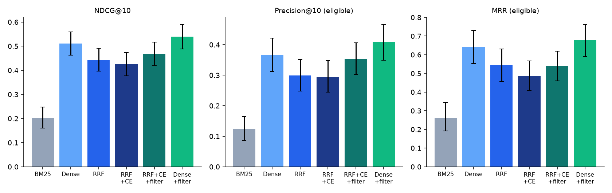

# TrialMatch: matching patients to recruiting clinical trials

   

Describe a patient in plain language and get recruiting trials from ClinicalTrials.gov, ranked
by relevance, with age and sex limits checked and the most relevant eligibility criteria shown.
Ranking methods are benchmarked on the TREC 2021 Clinical Trials track.

> Research prototype for education. Eligibility must be confirmed by the study team.



## Headline results

75 patient case descriptions and 35,810 expert relevance judgments (TREC 2021 Clinical Trials).

| System | NDCG@10 | Precision@10 (eligible) |
|---|---|---|
| BM25 keyword search | 0.202 | 0.124 |
| Hybrid (BM25 + dense, RRF) | 0.443 | 0.299 |
| Hybrid + cross-encoder re-ranking | 0.426 | 0.295 |
| Dense bi-encoder (bge-small) | 0.511 | 0.367 |
| **Dense + structured age/sex filter** | **0.539** | **0.408** |

Two findings went against the usual recipe:

1. **Hybrid search and cross-encoder re-ranking made results worse** than the dense model alone
   (NDCG@10 0.426 vs 0.511, p = 0.0005). Long clinical notes are poor keyword queries, and a
   re-ranker trained on short web questions does not transfer to them.
2. **Two simple rules from structured registry fields helped** (NDCG@10 0.511 to 0.539,
   p = 0.004), at the cost of wrongly demoting 172 of 5,548 filtered trials (3.1%).

Full tables with confidence intervals: [reports/RESULTS.md](reports/RESULTS.md).
Method and discussion: [reports/REPORT.md](reports/REPORT.md).

## Features

- Live search of the ClinicalTrials.gov API v2 (no API key), with country and status filters.
- Six ranking configurations behind one interface: BM25, dense, reciprocal-rank fusion,
  cross-encoder re-ranking, and rule-filtered variants.
- Rule-based eligibility checks from structured fields, plus criterion-level evidence: the
  inclusion and exclusion criteria most related to the patient description.
- Optional plain-English eligibility summary from a local LLM (Ollama) or the Anthropic API.
- Evaluation with NDCG@10, P@10, MRR, bootstrap confidence intervals and paired randomisation
  tests. GPU-accelerated; the full benchmark re-runs in a few minutes once data are cached.
- 17 unit tests.

## Quick start

```bash
python -m venv .venv
.venv\Scripts\activate            # Windows   (Linux/macOS: source .venv/bin/activate)
pip install -e ".[dev]"

streamlit run app/streamlit_app.py   # the matcher
python -m trialmatch.evaluate        # reproduce the benchmark (first run fetches 26k trials, ~20 min)
pytest
```

Optional AI summary: set `OLLAMA_MODEL=<model>` or `ANTHROPIC_API_KEY=<key>` before starting.

## Repository layout

```
src/trialmatch/  ctgov.py (API client), retrieval.py, eligibility.py, ir_metrics.py, evaluate.py
app/             Streamlit app
reports/         REPORT.md, RESULTS.md, metrics.json, figures/
tests/           unit tests
```

## Data and credits

- Trial records: ClinicalTrials.gov, U.S. National Library of Medicine (public domain).
- Topics and judgments: TREC 2021 Clinical Trials track, NIST (Roberts et al., 2021).
- Models: `BAAI/bge-small-en-v1.5`, `cross-encoder/ms-marco-MiniLM-L-6-v2`.

## Author

Hariharan S, Department of Biomedical Engineering.

## License

Copyright (c) 2026 Hariharan S. **All rights reserved.** This repository is public for viewing
and evaluation only. Copying, reuse or redistribution of the code, text, figures or models
needs written permission from the author. See [LICENSE](LICENSE). ClinicalTrials.gov records and TREC topics belong to their publishers.
